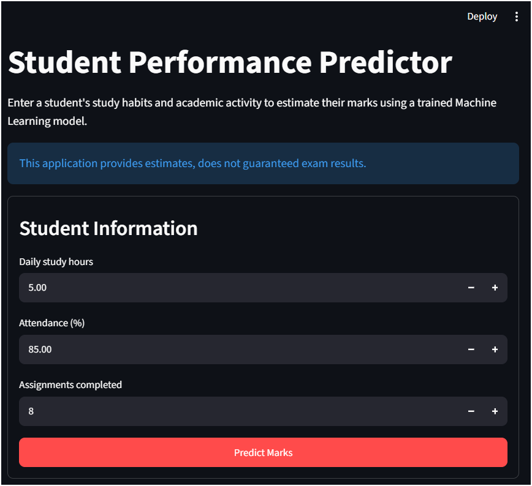

# Student Performance Predictor

A small ML project that predicts a student's marks from 0 to 100 from three things:
- daily study hours
- attendance
- assignments completed

## Application Preview



## Features
- Generate realistic student performance data
- Perform data preprocessing and data cleaning
- Train multiple ml models
- Compare model performance automatically
- Save best-performing model
- Predict student marks using a Streamlit web application


## Technologies Used
- Python
- Pandas
- NumPy
- Scikit-learn
- Streamlit
- Joblib

## What each file do?

- create_data.py : Makes 200 fake students and saves them to data/student_dataset.csv
- train_model.py : Cleans the data, trains Linear Regression and Random Forest Regressor, saves the better one to  `models/model.pkl` 
- app.py : Streamlit web page where you enter a student's details and see the predicted marks
- requirements.txt : The python libraries needed

## Model Performance
| Model | CV MAE | Test MAE | Test RMSE | Test R² |
|---------|---------|---------|---------|---------|
| Linear Regression | 3.14 | 4.00 | 5.12 | 0.878 |
| Random Forest Regressor | 3.77 | 4.47 | 5.58 | 0.856 |

## Best Performing Model
**Linear Regression**

```text
Cross Validation MAE : 3.14
Test MAE             : 4.00
Test RMSE            : 5.12
Test R²              : 0.878
```

## How to run (Follow this order)

```bash
pip install -r requirements.txt
python create_data.py
python train_model.py
streamlit run app.py
```

## Future Improvements

- Use real student performance datasets
- Add more features such as:
  - Sleep hours
  - Exam preparation time
  - Previous exam scores
- Deploy online using Streamlit Cloud
